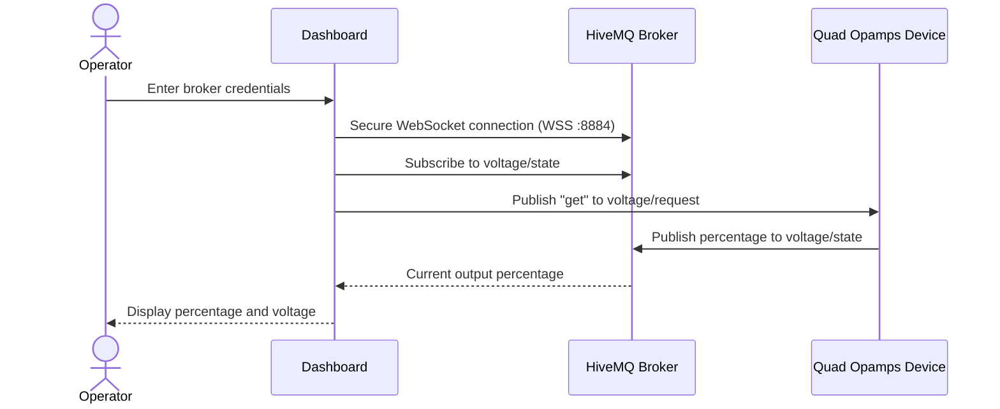
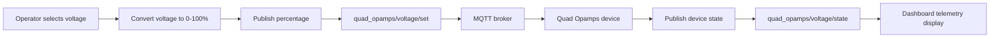

# Quad Opamps — Tech-A-Thon 2026

A browser-based control dashboard for the Quad Opamps voltage-output system. The dashboard connects to a HiveMQ-compatible MQTT broker over secure WebSockets, lets an operator request the current output value, and sends voltage setpoints to the device.

## Features

- Secure MQTT connection through browser WebSockets (`WSS`, port `8884`)
- HiveMQ broker, username, password, and device/client ID configuration
- Voltage control from `0.00 V` to `10.56 V`
- Slider and precise numeric voltage input
- Live device telemetry in percentage and volts
- Manual refresh of the current device value
- Connection status and boot/telemetry animations
- Responsive, industrial PCB-inspired interface

## Getting started

### Prerequisites

- A modern browser with JavaScript enabled
- Access to a HiveMQ Cloud or compatible MQTT broker
- A device or service publishing the MQTT topics described below

### Run locally

This is a static website and does not require a package manager, build tool, or backend server.

1. Clone or download this repository.
2. Open `index.html` in a browser.
3. Enter the MQTT broker hostname and credentials.
4. Enter a unique client/device ID if the default is already in use.
5. Select **INITIALIZE LINK**.

For browsers that restrict local files or for a more production-like setup, serve the repository with any static file server. For example:

```powershell
python -m http.server 8000
```

Then open <http://localhost:8000>.

## MQTT interface

The dashboard uses these topics:

| Topic | Direction | Payload | Purpose |
| --- | --- | --- | --- |
| `quad_opamps/voltage/set` | Dashboard → device | Integer percentage, `0`–`100` | Set the requested output level |
| `quad_opamps/voltage/state` | Device → dashboard | Integer percentage, `0`–`100` | Report the current output level |
| `quad_opamps/voltage/request` | Dashboard → device | `get` | Request the current output level |

The dashboard converts the percentage to volts using:

```text
voltage = (percentage / 100) × 10.56
```

The device should publish its response to `quad_opamps/voltage/state` after receiving a request. The dashboard subscribes to this state topic immediately after connecting.

### Connection and telemetry flow



### Voltage control flow



## Configuration

Connection settings are entered in the **HIVEMQ SETUP** panel:

| Field | Description |
| --- | --- |
| Broker Hostname | Hostname only, without `https://`, `wss://`, or a port |
| Username | MQTT broker username |
| Password | MQTT broker password |
| Device ID | MQTT client ID; defaults to `quad_opamps_gui` |

The application connects to `wss://<broker-hostname>:8884/mqtt` using TLS.

## Project structure

```text
.
├── index.html   # Dashboard markup and MQTT library reference
├── app.js       # MQTT connection, messaging, telemetry, and controls
├── style.css    # Dashboard layout, visual theme, and responsive styles
└── README.md    # Project documentation
```

The Paho MQTT browser client is loaded from CDN in `index.html`, and the dashboard uses Google Fonts for its display typography.

## Security notes

- Do not commit broker credentials or hard-code them into the source.
- Credentials entered in the dashboard are used directly by the browser to establish the MQTT connection.
- Use a broker account with only the permissions required by this dashboard, ideally restricted to the three `quad_opamps/voltage/*` topics.
- Serve the dashboard over HTTPS when deploying it. Secure WebSocket connections may be blocked when a page is served from an insecure origin.
- Use a unique MQTT client ID for each simultaneously connected dashboard.

## Team

**Quad Opamps**

- Rajas Wagle
- Dhruv Warik
- Vivaan Tasker
- Soham Shah

Project: **Tech-A-Thon 2026**
